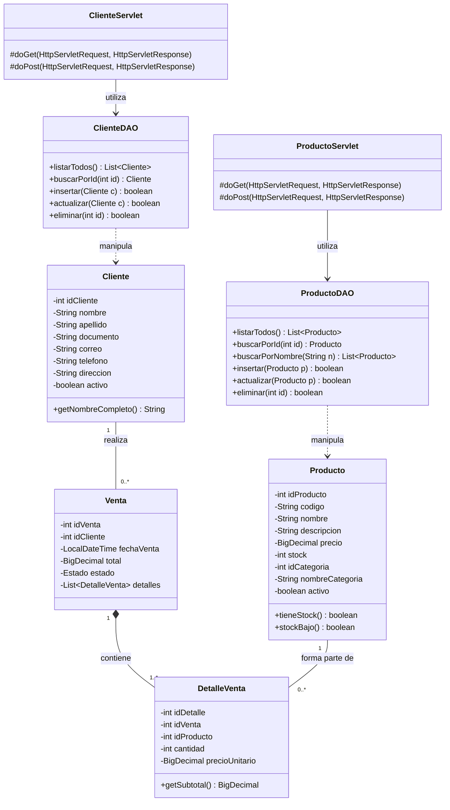

# 🛒 Sistema de Ventas Web - TiendaWeb
## Evidencia GA7-220501096-AA2-EV02: Módulos de software codificados y probados

**Programa:** Tecnología en Análisis y Desarrollo de Software (ADSO) - SENA  
**Aprendiz:** Jaider Stiven Londoño Lozada  
**Tecnologías:** Java 11 / Jakarta EE Servlets, JSP, JSTL, JDBC, MySQL, HTML5, CSS3, JUnit 5, Git  

---

## 📋 1. Descripción del Proyecto

El presente proyecto corresponde al desarrollo y prueba del módulo de **Gestión de Productos, Clientes y Ventas**, enfocado a la web mediante la tecnología de **Java Servlets** y **JSP (JavaServer Pages)**, cumpliendo a cabalidad con la guía de aprendizaje del SENA y los artefactos de análisis y diseño previamente construidos.

### Características Principales:
- **Arquitectura Modelo-Vista-Controlador (MVC)** desacoplada.
- **Controladores (Servlets)**: Manejo estricto de peticiones HTTP `GET` y `POST`.
- **Vistas (JSP)**: Uso de directivas, Expression Language (`${}`), etiquetas JSTL (`<c:forEach>`, `<c:if>`, `<c:choose>`) y diseño responsivo.
- **Persistencia (DAO/JDBC)**: Operaciones CRUD con consultas parametrizadas (`PreparedStatement`) para prevenir inyecciones SQL.
- **Pruebas de Software**: Suite de pruebas unitarias automatizadas con JUnit 5.
- **Control de Versiones**: Proyecto versionado con Git.

---

## 📐 2. Artefactos del Ciclo de Vida del Software

### 2.1 Diagrama de Clases (UML)


### 2.2 Historias de Usuario
| ID | Como... | Deseo... | Para... |
|---|---|---|---|
| **HU-01** | Administrador | Listar y buscar productos en el sistema | Supervisar el inventario disponible en tiempo real |
| **HU-02** | Administrador | Registrar nuevos productos mediante formulario web | Incorporar nuevas referencias comerciales a la tienda |
| **HU-03** | Administrador | Modificar datos de productos existentes | Mantener actualizados precios y cantidades |
| **HU-04** | Administrador | Registrar y gestionar clientes | Asociar las ventas con su documento y datos de contacto |

---

## 🔄 3. Métodos HTTP Implementados

### 3.1 Peticiones HTTP GET (`doGet`)
Utilizadas para consultar y recuperar información sin efectos secundarios:
- `GET /inicio` : Renderiza el dashboard principal con conteos y productos destacados.
- `GET /productos` : Consulta todos los productos en la base de datos y los envía al JSP.
- `GET /productos?accion=buscar&nombre=audifonos` : Filtra productos por término de búsqueda.
- `GET /productos?accion=nuevo` : Carga la vista con el formulario HTML vacío para nuevo registro.
- `GET /productos?accion=editar&id=1` : Consulta el producto por ID y lo precarga en el formulario.
- `GET /productos?accion=eliminar&id=1` : Ejecuta la baja lógica del producto y redirecciona.
- `GET /clientes` : Lista los clientes activos.

### 3.2 Peticiones HTTP POST (`doPost`)
Utilizadas para enviar información sensible o que modifique el estado en el servidor:
- `POST /productos` (con `accion=guardar`) : Recibe los campos del formulario HTML (`codigo`, `nombre`, `precio`, `stock`, `idCategoria`), los valida, construye el objeto `Producto` y llama a `ProductoDAO.insertar()`.
- `POST /productos` (con `accion=actualizar`) : Recibe los campos actualizados junto con `idProducto` oculto (`type="hidden"`) y llama a `ProductoDAO.actualizar()`.
- `POST /clientes` (con `accion=guardar`) : Inserta un nuevo cliente en base de datos.
- `POST /clientes` (con `accion=actualizar`) : Actualiza un cliente existente.

---

## 🗄️ 4. Base de Datos (MySQL)

El script SQL completo se encuentra en `sql/tienda.sql`.

### Estructura de Tablas:
1. `categorias`: Clasificación de productos.
2. `productos`: Catálogo con código único, nombre, precio, stock y llave foránea a categoría.
3. `clientes`: Datos personales de compradores (documento, correo, teléfono, dirección).
4. `ventas`: Encabezado de transacciones con total, estado y fecha.
5. `detalle_ventas`: Renglones de venta con cantidad, precio unitario y subtotal generado.

Para crear la base de datos:
```sql
SOURCE sql/tienda.sql;
```

---

## 🧪 5. Pruebas Unitarias de Software

Se diseñaron e implementaron casos de prueba automatizados con **JUnit 5**:
- `ProductoTest`:
  - `CP01`: Verifica disponibilidad con stock positivo (`assertTrue`).
  - `CP02`: Verifica disponibilidad con stock 0 (`assertFalse`).
  - `CP03`: Validación de regla de negocio para alerta de stock bajo (< 5).
  - `CP04`: Validación de stock normal (>= 5).
  - `CP05`: Integridad de getters y setters del modelo.
- `ClienteTest`:
  - `CP06`: Concatenación de nombre y apellido (`getNombreCompleto`).
  - `CP07`: Asignación y verificación de campos obligatorios.
- `DetalleVentaTest`:
  - `CP08`: Cálculo del subtotal (`cantidad * precioUnitario`).
  - `CP09`: Manejo de valores de precio nulos.

---

## 🚀 6. Instrucciones de Ejecución

### Prerrequisitos:
- JDK 11 o superior.
- Apache Maven 3.6+.
- Servidor MySQL activo en `localhost:3306` con base de datos `tienda_db`.
- Servidor de aplicaciones Jakarta/Tomcat 10+ (o ejecutar via plugin Maven).

### Pasos:
1. Importar el script en MySQL:
   ```bash
   mysql -u root -p < sql/tienda.sql
   ```
2. Ejecutar las pruebas unitarias:
   ```bash
   mvn test
   ```
3. Construir el paquete WAR:
   ```bash
   mvn clean package
   ```
4. Desplegar `tienda-web.war` en la carpeta `webapps/` de Apache Tomcat y abrir:
   `http://localhost:8080/tienda/` o `http://localhost:8080/tienda/inicio`
